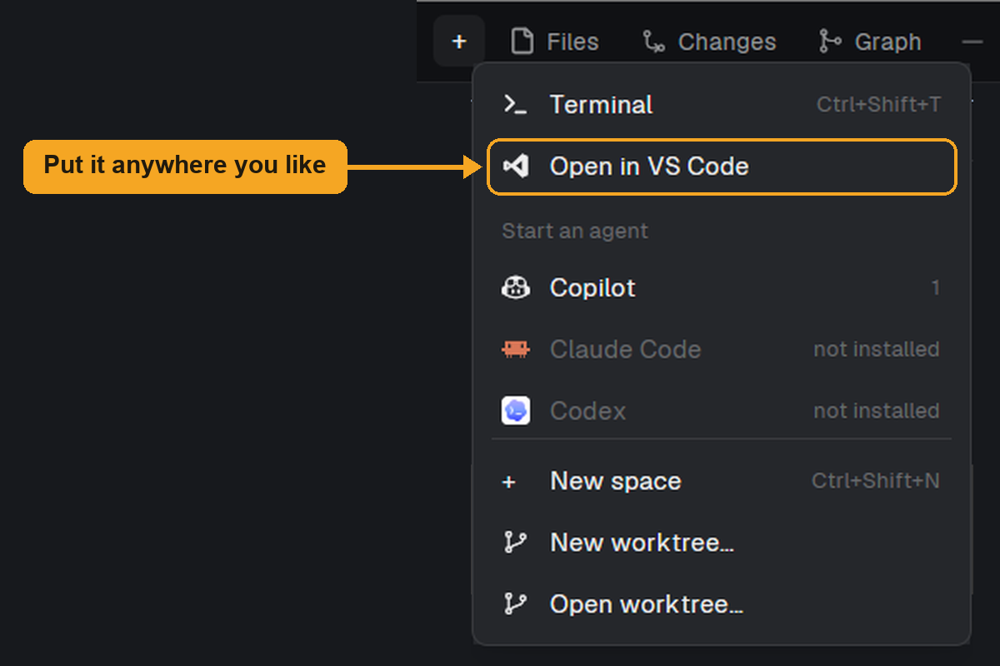

# herdr-open-vscode

A [Herdr](https://herdr.dev) mod: open the folder of your focused terminal in VS Code with a key or a button.

Works with:

- Folders on this computer
- Folders on any machine connected to Herdr over SSH, through the [Remote - SSH](https://marketplace.visualstudio.com/items?itemName=ms-vscode-remote.remote-ssh) extension



The mod adds no button of its own. This is one place to put it: a row in the + menu, set up as [below](#add-it-to-the--menu).

**Tested so far:** local folders on macOS and Windows, and from Windows to a Mac and to WSL over Remote - SSH, with capitalized Hosts. The URIs have unit tests.

## Install

Needs VS Code, plus Remote - SSH for other machines.

Ask your agent to add `https://github.com/CacaoRick/herdr-open-vscode`, or copy `mods/open-vscode/` to `mods/` in your Herdr folder (`~/.config/herdr-app`).

This adds no panel or button. Choose how to start it below.

## Use

The mod runs when something calls `mod.open` with its name, so you can put it wherever suits your layout. Herdr's command palette can't list mods yet.

| Start it from | Set it up | Example |
|---|---|---|
| The + menu | Clone Herdr's menu, then add a row. See [below](#add-it-to-the--menu) | `run("mod.open", { name: "open-vscode" })` |
| A key | Add a binding under `global` in `keys.json`, or merge this repo's `keys.json` | `"ctrl-shift-e": "mod.open:open-vscode"` |
| A button or menu item | Call it from the click handler in your own mod | `.on_click(() => run("mod.open", { name: "open-vscode" }))` |
| A shell or script | Nothing to set up | `herdr-app do mod.open --name open-vscode` |

### Add it to the + menu

The + menu is one of Herdr's own mods, which are read-only, so it needs a clone. Clones don't receive Herdr's updates. These names are examples.

**1. Clone the menu.**

```sh
herdr-app do mod.clone '{"name":"new-menu","as":"my-new-menu"}'
```

**2. Add the row.** In `mods/my-new-menu/main.js`, add this line after the `terminal` row, or between any other two rows, wherever you want it in the menu:

```js
      .child(this.row("vscode", svg("mods/open-vscode/vscode.svg").size(14), "Open in VS Code", () => run("mod.open", { name: "open-vscode" })))
```

**3. Make room for it.** In the same `render`, add one row's height (31) to both numbers in the menu's height: `491` becomes `522`, and `167` becomes `198`.

**4. Point the + button at your menu.** This depends on your layout:

- **You use Herdr's `main` layout:** clone the tab bar and the layout. `layout.clone` also switches you to the clone. Then, in `layouts/my-layout.json`, change the block with `"mod": "tabs"` to `"mod": "my-tabs"`.

  ```sh
  herdr-app do mod.clone '{"name":"tabs","as":"my-tabs"}'
  herdr-app do layout.clone '{"name":"main","as":"my-layout"}'
  ```

- **Your layout already uses your own tab bar:** skip the clones and edit that mod.

Then, in `main.js` of your tab bar, change the + button's `openOverlay` call:

```js
openOverlay({ mod: "my-new-menu", kind: "popup", width: 250, height: 543 })
```

**5. Check it.** Run `herdr-app check` on each mod you changed, for example `herdr-app check ~/.config/herdr-app/mods/my-new-menu`.

## If the host doesn't match

The mod uses the machine's ssh target from `hc machine ls`. If VS Code needs another name, or the machine was added with `--via`, create `mods/open-vscode/hosts.json`:

```json
{ "mac": "mac-studio" }
```

The key is the machine's name in Herdr; the value is a Host your ssh config knows.

## If VS Code stays on loading

If the window opens but its Explorer keeps loading, VS Code may be downloading its server on the other machine, which only happens the first time. Check that machine's download speed. On WSL, a slow network can be fixed by setting `networkingMode=mirrored` under `[wsl2]` in `%USERPROFILE%\.wslconfig`, then running `wsl --shutdown`.

## What it touches

It runs `code`, `powershell`, `open` or `xdg-open`, and `hc` on this computer, and reads its own `hosts.json`. It has no network access of its own.

## License

MIT
