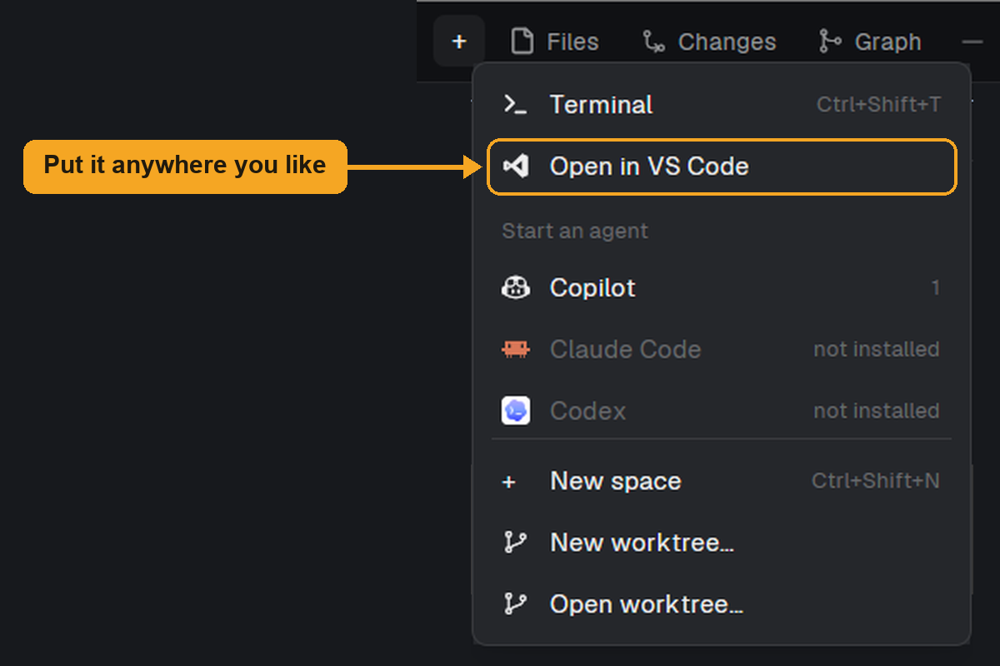

# Open in VS Code

Press a key and the folder of the focused terminal opens in VS Code on the computer in front of you. If that terminal is on another machine, VS Code opens it through the Remote - SSH extension: the window is here, the files stay there. It's the `code .` of WSL, for any machine added to Herdr. A folder on this computer simply opens locally.

## What you see

Nothing in the window until it's called: no panel, no block, no layout change.

When called, a centered dialog, 460×112 px, on the `popover` background with 16 px padding and 6 px between its lines:

- First line, 13 px semibold, `foreground`: `Opening in VS Code…`.
- Second line, 12 px, `muted`: the folder, prefixed with `<machine>:` when it's on another machine.

It closes by itself as soon as VS Code has been started, usually too fast to read. If that fails, it stays, the first line becomes `Could not open VS Code` in the theme's `blocked` color and the second line gives the reason.

## How it behaves

- `mod.open {name: "open-vscode"}` runs it, once, each time it's opened. Nothing runs in the background and there's no agent status to show.
- The folder is `focused().cwd`, the focused terminal's live folder, else the folder of the space in `focused().space`, else the active space's. No folder at all: the error `This space has no folder yet.`
- The machine is that space's `machine`. Null means this computer.
- The host for ssh is the entry in `mods/open-vscode/hosts.json` for that machine name (`{"mac": "mac-studio"}`, optional), else the machine's `target` in `hc machine ls --json`. A machine reached with `--via`, or one with no usable target, gets an error naming `hosts.json`.
- Esc closes the dialog, as with any dialog.
- `keys.json` binds `ctrl-shift-e` and `cmd-shift-e`. Merge them, or bind anything else, or call `run("mod.open", { name: "open-vscode" })` from a button in your own layout.

## Built from

- `mods/open-vscode/mod.json`: `{ "place": "none", "title": "Open in VS Code", "overlay": { "kind": "dialog", "width": 460, "height": 112 } }`.
- `mods/open-vscode/uri.js`: pure functions, tested with `bun test`.
  - `uriPath`: backslashes to slashes, a leading `/` before a drive letter, each segment percent-encoded.
  - `sshAuthority`: `ssh-remote+<host>`, or `ssh-remote+<hex of {"hostName":"<host>"}>` when the host has anything but `[a-z0-9._@-]`.
  - `folderUri`: `vscode-remote://<authority><path>`, or `file://<path>` locally.
  - `protocolUrl`: `vscode://vscode-remote/<authority><path>`, or `vscode://file<path>` locally.
  - `resolveHost`: as above.
- `mods/open-vscode/main.js`: a `View` that does everything from `init`, inside `cx.spawn`, then calls `closeOverlay(props().overlay)`.
- Herdr: `focused`, `spaces`, `theme`, `window`, `exec`, `hc`, `readTextFile`, `appHome`, `closeOverlay`, `props`.
- `mods/open-vscode/vscode.svg`: a one-color icon, not used by the mod itself, for whoever adds it to a menu or button.
- Programs, run on this computer, never on the remote machine:
  - Windows: `powershell -NoProfile -Command`, running `code --folder-uri <uri>` if `Get-Command code` finds it, else `Start-Process <protocol url>`.
  - macOS and Linux: `code --folder-uri <uri>`, else `open` or `xdg-open` with the protocol URL.
  - `hc machine ls --json`, only for a folder on another machine.

## Watch out

- The palette can't list it. Palette entries come from Herdr's own list, the layouts and `commands()`; `mod.json` can't add one and `mod.open` is hidden there. A key or a button is the way in.
- `programs.json` can't do this: a `run` entry starts on the space's machine, so VS Code would start over there.
- VS Code lowercases URI authorities, so a Host with capitals, like `MacStudio`, must be hex-encoded or it won't match ssh config.
- Herdr's JS has no `TextEncoder` (nor other web globals), and `bun test` won't notice: it has them. Prove `uri.js` inside Herdr too, e.g. a throwaway mod that asserts its output under `herdr-app check`.
- Encode more than `encodeURIComponent` does: `!'()*` too. On Windows the URI passes through PowerShell and `code.cmd`.
- The host must mean the same thing to this computer's ssh as to Herdr. Herdr's `target` normally does, because it came from the same ssh config.
- `hosts.json` lives in the mod's folder and holds machine names, so don't publish yours.
- Assumes VS Code here, with Remote - SSH for other machines. VS Code's own forks aren't handled. Only ssh remotes are.
- Reads `~/.config/herdr-app/mods/open-vscode/hosts.json`. Runs `code`, `powershell`, `open` or `xdg-open`, and `hc`. No network of its own; Remote - SSH makes the connection.

## Done when

- `herdr-app check mods/open-vscode` passes and `bun test` passes.
- In a terminal on this computer, `herdr-app do mod.open --name open-vscode` opens that folder in VS Code and the dialog closes by itself.
- In a terminal on another machine, the same command opens a Remote - SSH window on that terminal's folder, also with spaces and non-ASCII characters in the path.
- After `cd` in the terminal, it opens the new folder, not the space's first one.
- A machine with no usable host shows the error naming `hosts.json`, and Esc closes it.
